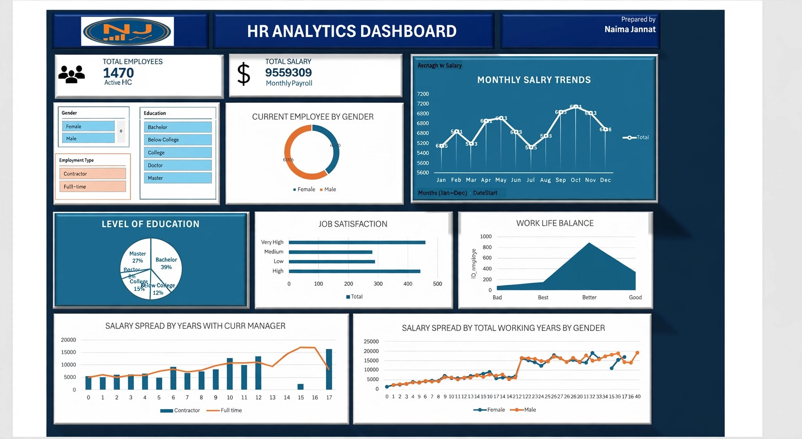

# HR Analytics Dashboard

An interactive Excel dashboard analyzing 1,470 employee records to uncover workforce trends.

## Tools
Advanced Excel, PivotTable, Charts

## Key Findings
- Gender mix: 60% male, 40% female
- Bachelor's degree holders: 37% of employees
- Job satisfaction gaps identified across roles
- Role-wise and education-wise salary breakdowns

## Dashboard Preview

